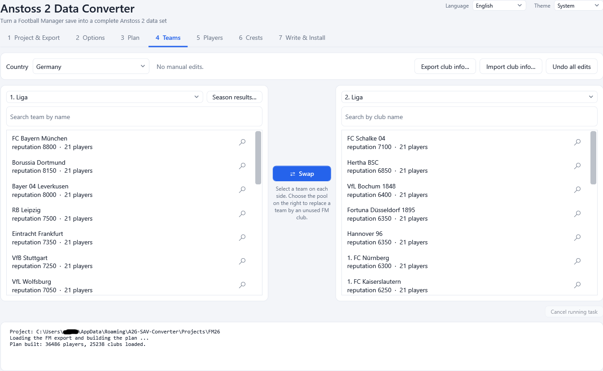
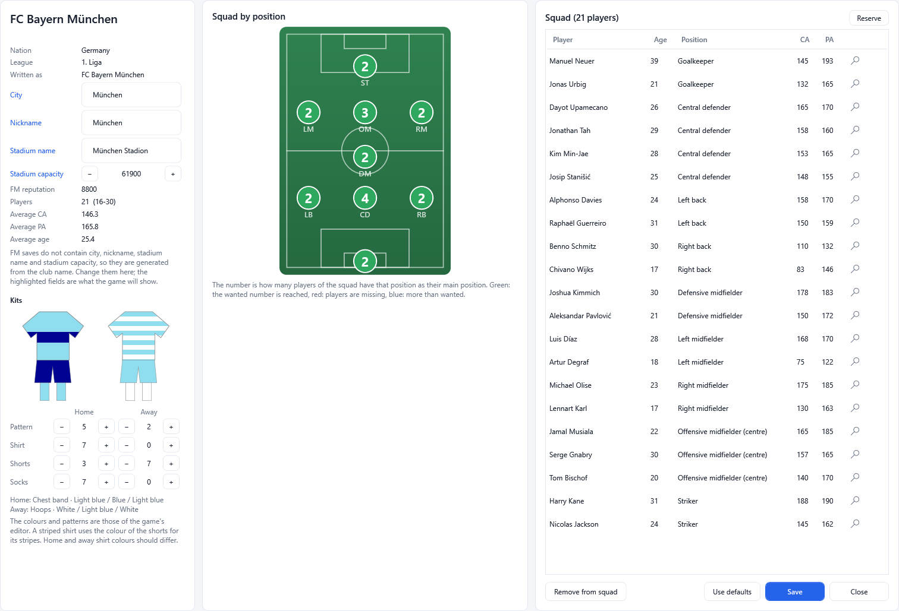
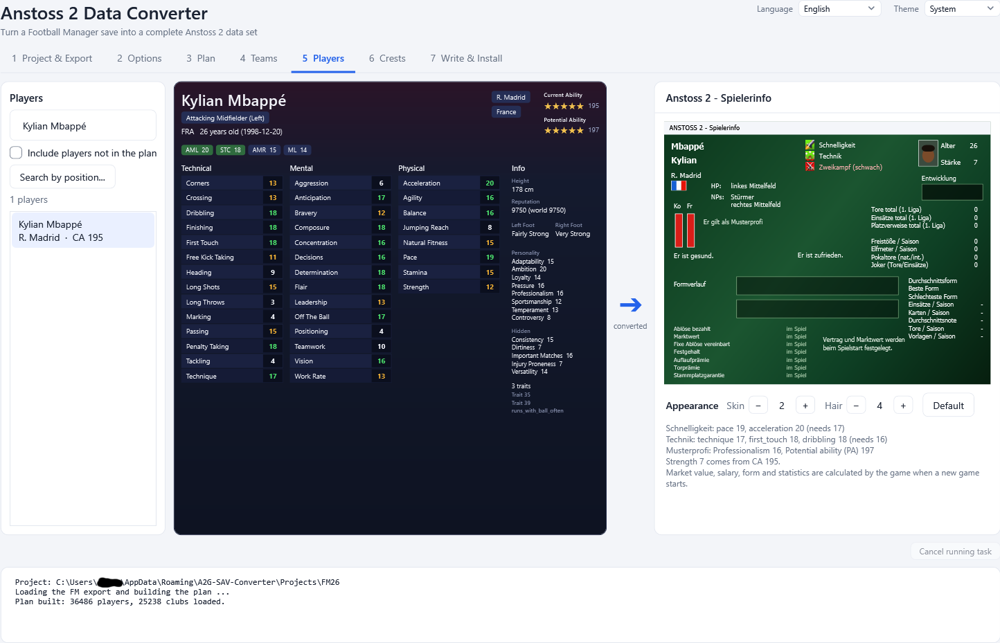
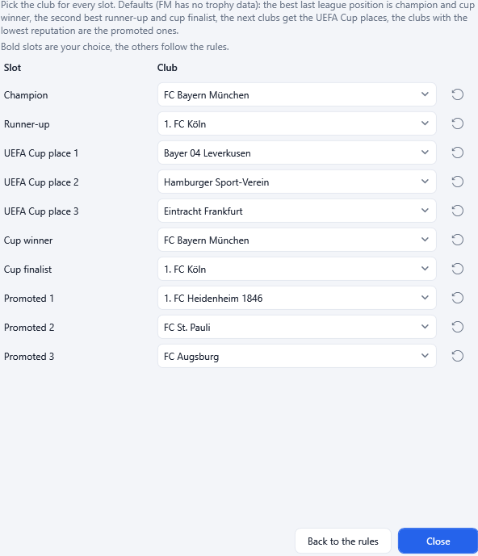
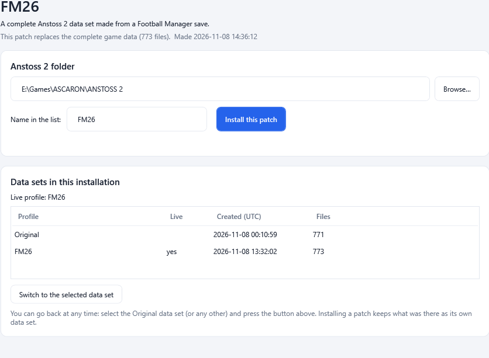

# A2G-SAV-Converter

Turn a Football Manager 26/27 save into a complete Anstoss 2 data set.

  

Real clubs, leagues, players, staff, name pools, stadiums, kits and crests from Football Manager, playable in Anstoss 2. Review and
fine-tune everything inside the program, install it safely with a way back to the original data, and pack your work into **one `.exe`
patch file** that anyone can install with a few clicks.

**Built on .NET Framework 4.8**, A2G-SAV-Converter is a single file that runs on Windows 10 and 11 out of the box. There is no installer
and nothing else to download. It works offline and comes in English and German.

---

## 🚀 How to Use

1. **Download** the latest `A2G-SAV-Converter.exe` from the [Releases](https://github.com/strajk-/A2G-SAV-Converter/releases) page and
   start it from any folder.
2. On tab **1 Project & Export**, choose your Football Manager save (**Browse**, or drop the `.fm` file onto the window). Your
   **Anstoss 2 folder** is found automatically in most cases. Press **Export from FM save**.
3. On tab **3 Plan**, press **Build plan from export**. Then, if you like, review the **Teams**, **Players** and **Crests** tabs: swap
   clubs between leagues, edit squads, club names, stadiums, kits and the results of the last season.
4. On tab **7 Write & Install**, press **Write .sav files to project**, close Anstoss 2 and press **Install**. Your conversion becomes a
   new data set and the original data stays safe as **Original**.
5. To go back at any time, select **Original** in the list of data sets and press **Activate selected**.

> ⚠️ **Note:** Use a **fresh career save** (the start of a new career with all the leagues you want loaded). A save from a long career
> contains generated future players instead of the real ones. Football Manager does not have to be installed.

Want to share your work? Press **Generate patch file...** on the same tab. The result is a single `A2G-Patch_<name>.exe` that installs your
data set into any Anstoss 2 and can switch back to the original data. See [Patch files and the patcher](docs/User/10-patches.md).

---

## ✨ Features

- **Football Manager to Anstoss 2:** clubs, leagues, squads, strength, positions, abilities, traits, characters, staff and name pools
  from an FM26 or FM27 save, with all the game's limits respected and checked.
- **Everything editable:** swap teams between leagues, fill squads by position, change city, nickname, stadium name and capacity,
  design kits, set the results of the last season, pick skin and hair, all with live previews.
- **Excel round trip:** export the club information of every club to a formatted workbook and import it again.
- **Your own crests:** import images or paint 32x32 crests pixel by pixel; the rest are generated in the club's colours.
- **Safe installs:** every install is a data set of its own; switch back to the original data with one click.
- **Projects and a shared library:** named projects you can reopen for minor edits, and club texts, kits and crests that carry over to new
  projects.
- **Patch files:** one `.exe` with your data set and a small installer window, plus a quiet install mode (`-q`, `-F`) for installers.
- **Light and dark theme, English and German.**

---

## 📸 Screenshots

<table>
  <tr>
    <td width="50%"></td>
    <td width="50%"></td>
  </tr>
  <tr>
    <td align="center">Team information: club texts, kits, squad by position</td>
    <td align="center">Players: the FM profile and the Anstoss 2 "Spielerinfo"</td>
  </tr>
  <tr>
    <td width="50%"></td>
    <td width="50%"></td>
  </tr>
  <tr>
    <td align="center">Results of the last season: pick a club for every slot</td>
    <td align="center">The patcher: install a patch file and switch data sets</td>
  </tr>
</table>

---

## 📚 Documentation

The complete **[user guide](docs/User/README.md)** covers every tab and feature:

| | |
|---|---|
| [Getting started](docs/User/01-getting-started.md) | Requirements, first start, the seven steps |
| [Project and export](docs/User/02-project-and-export.md) | Projects, the FM save, the export |
| [Options](docs/User/03-options.md) | Squad rules, strength bands, abilities, traits |
| [Teams](docs/User/05-teams.md) | Swapping, squads, kits, club information, season results |
| [Players](docs/User/06-players.md) · [Crests](docs/User/07-crests.md) | Previews, skin and hair, your own crests |
| [Write and install](docs/User/08-write-and-install.md) · [Data sets and rollback](docs/User/09-profiles.md) | Installing and going back |
| [Patch files and the patcher](docs/User/10-patches.md) · [Command line](docs/User/14-command-line.md) | Sharing your work, quiet install for installers |
| [How the conversion works](docs/User/11-how-conversion-works.md) · [Troubleshooting](docs/User/13-troubleshooting.md) | The rules behind the result, problems and FAQ |

Developers: [architecture and repository layout](docs/Dev/architecture.md), file formats and conversion rules are in
[`docs/Dev`](docs/Dev/).

---

## 📦 Embedded Dependencies

The release is one file: the program's libraries and the Football Manager reader are built into it.

- **[fmsave](https://github.com/rhiever/fmsave)** (0.10.0, Randal S. Olson, MIT) reads the Football Manager save. It is embedded in the
  `.exe` and unpacked once into `%LOCALAPPDATA%\A2G-SAV-Converter\fmsave` the first time it is needed.
- **A2G.Sav** and **A2G.Convert**, this project's own libraries, are embedded as well.

Python is only needed to build the reader from source, never to run the program.

---

## 🛠️ Building from Source

1. `powershell -ExecutionPolicy Bypass -File tools\build-fmsave.ps1` builds the embedded reader (needs Python 3.12+; only for this step).
2. Open `A2G-SAV-Converter.sln` in Visual Studio, or run `dotnet build`.
3. `powershell -File tools\publish.ps1` builds the single-file release into `dist\` and checks it.
4. `powershell -File tests\run-checks.ps1 -Anstoss2 "<Anstoss 2 folder>" -FmExport "<fm_export folder>"` runs all automated checks on
   scratch copies; nothing touches a real install.

See [`docs/Dev/architecture.md`](docs/Dev/architecture.md) for the layout of the code.

---

## ⚖️ Licensing & Third-Party Notices

The source code of A2G-SAV-Converter is licensed under the **GNU General Public License, version 3** (GPL-3.0): see [LICENSE](LICENSE).

This tool embeds or contains third-party material, which keeps its own rights and licenses:

- **fmsave:** MIT License, Copyright (c) Randal S. Olson. Its license is kept in [`third_party/fmsave`](third_party/fmsave).
- **Anstoss 2:** the national flags and ability icons shown in the program are taken from the game and remain the property of their
  owners. The program reads and writes the game's data files; it does not contain the game.

This is an unofficial community tool. It is not affiliated with, authorised or endorsed by Ascaron, Sports Interactive or SEGA. "Anstoss",
"Football Manager" and all related names and game data belong to their respective owners.
