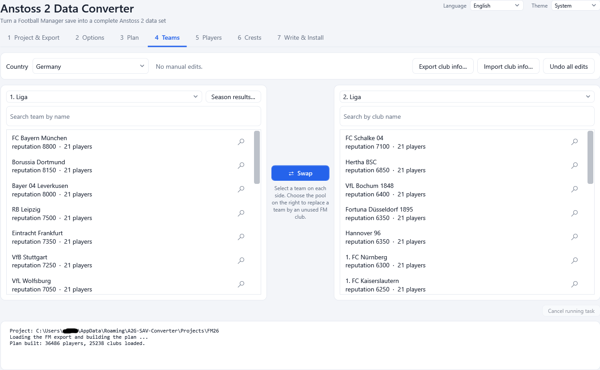
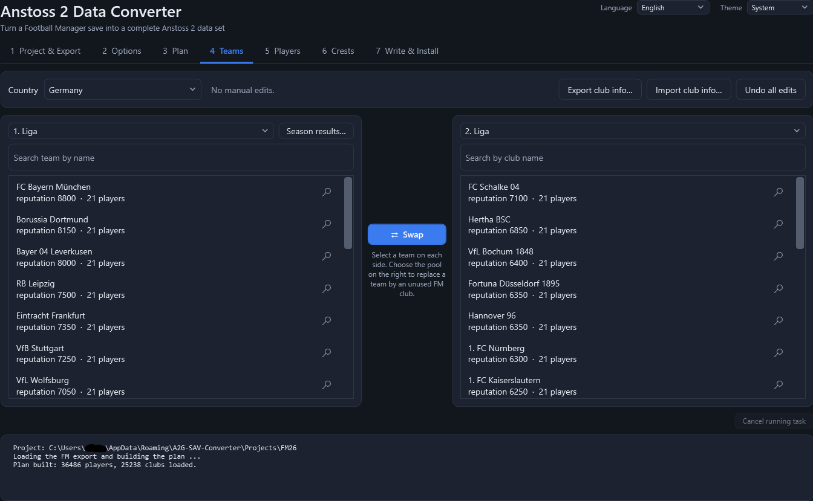

# 1. Getting started

## What you need

- **Windows 10 or 11.** The program is a normal Windows application (it uses .NET Framework 4.8, which is part of Windows 10 and 11).
- **Anstoss 2** installed on the PC (or a copy of its folder). The converter reads the original data files from it as templates and
  installs the result into it. The Anstoss 2 folder is the folder that contains `anstoss2.exe` and the two folders `DATA.DEF` and
  `DATA.VER`.
- A **Football Manager 26 or 27 save** (a `.fm` file). Football Manager itself does **not** have to be installed. Use a
  **fresh career save**: the start of a new career with all the leagues you want loaded. A save from a long career contains generated
  future players instead of the real ones.
- Nothing else. Python, fmsave and all libraries are built into the program.

The program is **one single file**, `A2G-SAV-Converter.exe` (about 12 MB). There is nothing to install: copy it anywhere and start it.

## First start

1. Start `A2G-SAV-Converter.exe`. The window opens on tab **1 Project & Export**.
2. The program looks for your Anstoss 2 folder by itself (usual install locations and the fixed drives). If it finds it, the **Anstoss 2
   folder** field is already filled in; otherwise press **Browse** and choose it.
3. Press **Browse** next to **FM save (.fm)** and pick your save (or drop the `.fm` file onto the window).
4. Press **Export from FM save**.
5. Continue with the tabs from left to right. Tabs that cannot be used yet are greyed out.

The first start creates a project called **Default** in your user data folder (see [Files and folders](12-files-and-folders.md)). You can
create further projects at any time; see [Project and export](02-project-and-export.md).

## The seven steps

*The converter window. The seven steps are the tabs along the top; the language and theme boxes are in the top right corner.*

| Tab | Purpose | Needs |
|-----|---------|-------|
| **1 Project & Export** | Choose the project, the FM save and the Anstoss 2 folder; export the FM data | - |
| **2 Options** | Squad rules, strength bands, ability and trait rules | - |
| **3 Plan** | Build the conversion plan from the export and your options | an export |
| **4 Teams** | Swap teams, edit squads, club information, kits, results of the last season | a plan |
| **5 Players** | Inspect players and the Anstoss 2 preview, skin and hair | a plan |
| **6 Crests** | Optional: your own crests | a plan |
| **7 Write & Install** | Write the data files, install them into the game, switch data sets, generate a patch file | a plan |

You do not have to visit every tab. The shortest path is: export, build the plan, write the files, install.

## Language and theme

In the top right corner of the window:

- **Language** - English or German. The default follows your Windows display language; any other language falls back to English.
- **Theme** - **System** (follows the Windows light/dark setting), **Light** or **Dark**.

Both choices are remembered for your Windows user.

*The dark theme.*

## Dropping a save onto the window

You can drag a `.fm` file from Explorer onto the window at any time. The file is filled into **FM save (.fm)** and checked.

## The message area and Cancel

The area at the bottom of the window is the log: every step writes what it does, including warnings and errors. While the program is
busy (exporting, building, writing, installing) the **Cancel running task** button next to it stops the task.

## Where to go next

- A normal first conversion: [Project and export](02-project-and-export.md), then [Plan](04-plan.md) and
  [Write and install](08-write-and-install.md).
- To pass your work on to other players: [Patch files and the patcher](10-patches.md).
- If something goes wrong: [Troubleshooting and FAQ](13-troubleshooting.md).
