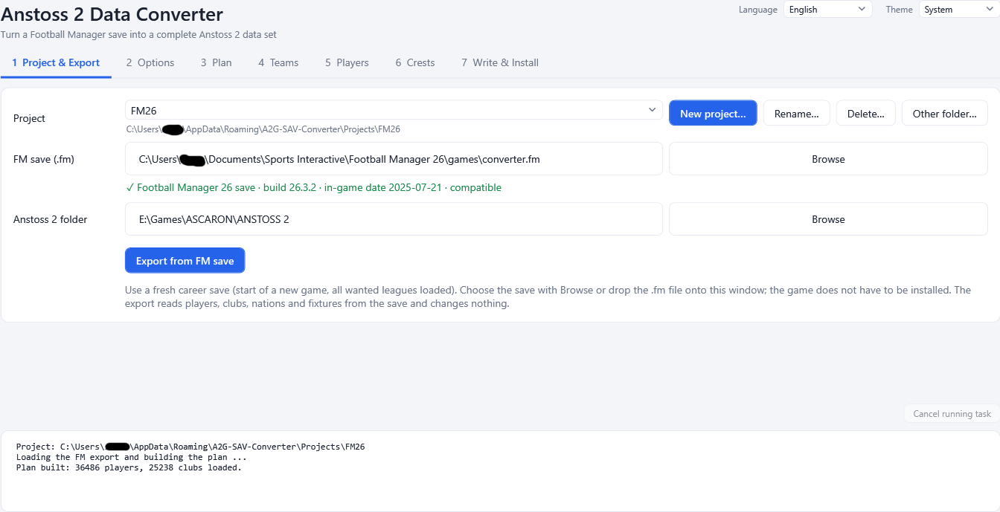

# 2. Project and export

Tab **1 Project & Export** has three jobs: pick the project you work in, tell the program where the FM save and Anstoss 2 are, and export
the data from the save.

*Tab 1: the project list with its buttons, the FM save with its status line, the Anstoss 2 folder and the export button.*

## Projects

Everything the converter produces for one conversion lives in one **project**: the exported FM data, your options and manual edits, the
written data files and your crest images. Projects have names and are kept side by side, so you can come back to any of them later for
minor edits or a new version.

At the top of the tab:

| Control | What it does |
|---------|--------------|
| **Project** list | Shows all your projects. Selecting one opens it. The folder of the open project is shown below the list. |
| **New project...** | Asks for a name and creates the project. The name is suggested from the FM version of your save (for example `FM26`, then `FM26-2`). |
| **Rename...** | Renames the open project. Data sets you installed earlier are not touched; a data set name is only a name. |
| **Delete...** | Deletes the open project and everything in it (exported data, settings, written files) after asking. Data sets already installed in Anstoss 2 are not affected. |
| **Other folder...** | Opens a project from any folder (for example one you received from someone else). Such a project is shown with its full path and is never renamed or deleted by the program. |

Good to know:

- The program **remembers the project you had open** and opens it again the next time.
- The **name of the project is the suggested name** of the data set when you install and of the patch file when you generate one
  (see [Write and install](08-write-and-install.md) and [Patch files](10-patches.md)).
- A new project starts empty. It does pick up your club information, kits and crests from the shared library
  ([Files and folders](12-files-and-folders.md)), so you do not start from zero.
- You can start the program with a project folder as its argument; see [Command line](14-command-line.md).

## The FM save

**FM save (.fm)** holds the path of the save. Use **Browse**, type the path, or drop the file onto the window.

As soon as a file is chosen, the program checks it and shows one line below the field:

| Line | Meaning |
|------|---------|
| `Football Manager 26 save · build 26.3.2 · in-game date 2025-07-21 · compatible` (green) | The save is supported. |
| `Football Manager NN save · not tested with this converter (FM26 and FM27 are supported)` | A newer version than the program knows; it may or may not work. |
| `Football Manager NN saves are not supported (FM26 or FM27 needed)` (red) | An older version; the program cannot read it. |
| `Not a usable Football Manager save: ...` (red) | The file could not be read. |
| `Pick a save file (.fm) with Browse, or drop it onto this window.` | No file chosen yet. |

Supported builds of FM26 are 26.1.0, 26.3.1 and 26.3.2; FM27 saves are read as well.

**Use a fresh career save.** Start a new career, load all the leagues you want to convert, save immediately. In a save from a long career
the world is full of generated players instead of the real ones.

The in-game date of the save is used later as the default **start year** of the game
([Write and install](08-write-and-install.md)).

## The Anstoss 2 folder

**Anstoss 2 folder** is the folder where `anstoss2.exe` is located; it contains `DATA.DEF` and `DATA.VER`. The program finds it
automatically in most cases (usual Program Files and games folders and a shallow search of the fixed drives). If the field is empty or
wrong, press **Browse**.

The converter reads the original data files of this folder as templates (record counts, stadium shapes, staff blocks and more) and the
**Write & Install** tab installs into it. Nothing in the folder is changed until you install.

## Exporting from the save

Press **Export from FM save**. The program reads these tables from the save and writes them as CSV files into the project's
`fm_export` folder:

- **players** - every player with attributes, abilities, positions, personality and club
- **clubs** - clubs with nation, reputation and last league position
- **nations** - the nations of the save
- **fixtures** - used to find out which clubs play in which league
- **staff** - coaches and other staff, used for the trainer and staff files
- **nation names** - FM saves only contain nation ids. The names are read from the installed Football Manager when the same version
  is installed on this PC; otherwise the program's built-in FM26 list is used. For an FM27 save without FM27 installed a few nation
  names may differ; the log tells you.

The save itself is never changed. The export takes a short while for big saves; the log shows each table. If one table fails, the log
names it and the export counts as unfinished.

After a successful export the program remembers the FM version and the in-game year of the data.

**Exporting again** (for example after choosing another save) replaces the exported data. Rebuild the plan afterwards
([Plan](04-plan.md)); your manual edits are kept and re-applied where they still fit.

## Messages you may see

| Message | What to do |
|---------|------------|
| `Select a save file (.fm) first.` | Choose a save. |
| `fmsave.exe is missing ...` | The program is incomplete. Use the original single `.exe` from the release. |
| `Export finished with errors in: ...` | Check the log lines above it; try exporting again. |

More in [Troubleshooting and FAQ](13-troubleshooting.md).

Next: [Options](03-options.md) (optional) or directly [Plan](04-plan.md).
