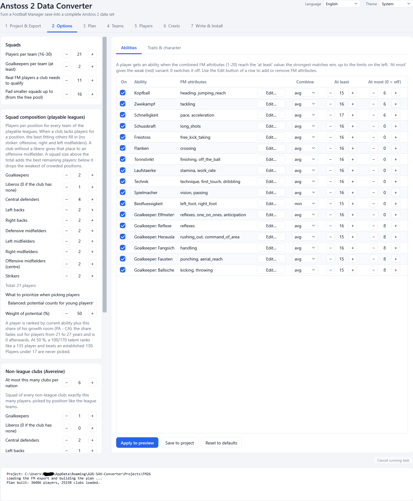
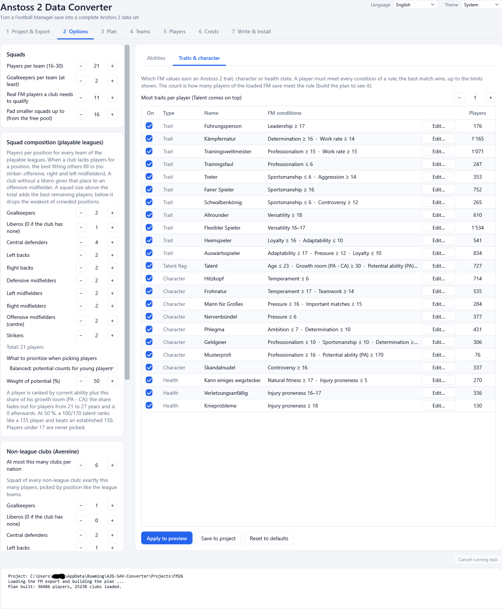

# 3. Options

Tab **2 Options** decides how the FM data becomes Anstoss 2 data. The defaults are sensible; change them only if you have a reason.
The settings belong to the project (each project has its own).

*Tab 2: squad rules and strength limits on the left, the ability rules on the right.*

Changes are made in three steps, with three buttons at the bottom:

| Button | What it does |
|--------|--------------|
| **Apply to preview** | Uses the edited settings for the preview in the **Players** tab right away (without saving). Squad changes need a new plan (step 3). |
| **Save to project** | Stores the settings in the project. They are used from now on. |
| **Reset to defaults** | Restores all defaults (not saved until you press **Save to project**). Your club information, kits, skin and hair changes, results of the last season and the start year are kept. |

A status line under the buttons tells you what happened. Wrong values are reported there as well (for example "Players per team must be
16 to 30.").

## Squads

| Setting | Default | Meaning |
|---------|---------|---------|
| **Players per team (16-30)** | 21 | How many players every team of the playable leagues gets. Anstoss 2 allows 16 to 30. |
| **Goalkeepers per team (at least)** | 2 | Minimum number of goalkeepers. |
| **Real FM players a club needs to qualify** | 11 | A club needs at least this many real players in the FM save to be given a team slot. |
| **Pad smaller squads up to (from the free pool)** | 16 | Clubs whose FM squad is too small (an FM save only loads some leagues completely) are topped up with free players of the club's nation. |

### Squad composition (playable leagues)

How many players of each position every team gets. A club that lacks players for a position gets the best fitting others (no striker:
offensive, right and left midfielders step in). A club without a libero gives that place to an offensive midfielder. A squad size above
the total adds the best remaining players; below it drops the weakest players of crowded positions.

| Position | Default |
|----------|---------|
| Goalkeepers | 2 |
| Liberos (0 if the club has none) | 1 |
| Central defenders | 4 |
| Left backs / right backs | 2 / 2 |
| Defensive midfielders | 2 |
| Offensive midfielders (centre) | 2 |
| Left midfielders / right midfielders | 2 / 2 |
| Strikers | 2 |
| **Total** | **21** |

The page shows the running total ("Total: n players").

### What to prioritize when picking players

Players are ranked inside a position by their current ability (CA) plus a share of their growth room (PA - CA), which fades out for
players from 21 to 27 years and is 0 afterwards. Choose:

- **Current ability only** - the best players now.
- **Balanced: potential counts for young players** - the default (weight 50 %): a 100/170 talent ranks like a 135 player.
- **Potential first: young talents win**
- **Custom** - set the **Weight of potential (%)** yourself.

Players under 17 are never picked (Anstoss 2 players are 17 to 50).

## Non-league clubs (Avereine)

Anstoss 2 contains 130 small clubs from 30 European nations that are not in a playable league ("Avereine"). They take part in
European competitions.

- **At most this many clubs per nation** (default 6) - limits how many clubs one nation may supply.
- Every Avereine club gets **exactly 11 players**: 1 goalkeeper, 2 central defenders, 1 left back, 1 right back, 1 defensive midfielder,
  1 offensive midfielder, 1 left midfielder, 1 right midfielder and 2 strikers. The list of numbers on the page lets you change this
  composition.

See [Players](06-players.md) for an important note about Avereine players.

## Strength (1-7) from Current Ability

Every player gets a strength from 1 to 7, derived from the FM **Current Ability (CA)**. Six limits decide where each value starts;
defaults:

| Strength | from CA |
|----------|---------|
| 1 | below 80 |
| 2 | 80 |
| 3 | 92 |
| 4 | 104 |
| 5 | 120 |
| 6 | 145 |
| 7 | 170 |

The limits must increase from left to right. Strength 8 is a random event inside the game and is **never** written.

## Stadiums

| Setting | Default | Meaning |
|---------|---------|---------|
| **Estimate stadium sizes from club reputation** | off | Off: every club gets the capacity of its home ground in the FM save (rounded to 100, between 3,000 and 110,000). Clubs for which the save has no ground (an FM save only knows the grounds of clubs whose matches are loaded) are estimated from their reputation. On: all clubs are estimated from their reputation. |

A capacity you set by hand for a club always wins. The plan summary shows how many clubs use the ground of the save.

## Positions and abilities

| Setting | Default | Meaning |
|---------|---------|---------|
| **FM position rating for a secondary position** | 15 | A player gets a secondary position when FM rates him at least this high there (0-20). Each player has one main and up to two secondary positions. |
| **Most positive abilities (1-2)** | 2 | A field player may have at most two (the game's limit). |
| **Most negative abilities (0-2)** | 1 | |

### Tab "Abilities": the ability rules

A table with one row per Anstoss 2 ability (Kopfball, Zweikampf, Schnelligkeit, Schusskraft, Freistoss, Flanken, Torinstinkt,
Laufstaerke, Technik, Spielmacher, Beidfuessigkeit and the goalkeeper abilities). Columns:

| Column | Meaning |
|--------|---------|
| **On** | Switches the rule on or off. |
| **Ability** | The Anstoss 2 ability. |
| **FM attributes** | The FM attributes that are looked at. **Edit...** opens a list where you add (**+ Add**) or remove (**Remove**) attributes. With no attribute the rule never matches. |
| **Combine** | How several attributes are combined (average or minimum). |
| **At least** | The combined value (1-20) a player needs to get the ability. |
| **At most (0 = off)** | The value up to which a player gets the weak (red) version of the ability; 0 switches that off. |

The strongest matches win, up to the limits on the left. Example default: **Schnelligkeit** needs the average of FM *pace* and
*acceleration* to be at least 17.

### Tab "Traits & character"

Rules for the Anstoss 2 **traits** (for example Fuehrungsperson, Kaempfernatur, Trainingsweltmeister), **characters** (Hitzkopf,
Frohnatur, Mann fuer Grosses, Nervenbuendel, Phlegma, Geldgeier, Musterprofi, Skandalnudel), **health states** (Wegstecken,
Verletzungsanfaellig, Knieprobleme) and the **Talent** flag.

| Column | Meaning |
|--------|---------|
| **On** | Rule on or off. |
| **Type** | Trait, character, health or talent. |
| **Name** | The Anstoss 2 name. |
| **FM conditions** | A player earns it when **every** condition holds. **Edit...** opens a list of conditions: an FM attribute or personality value, or the player's age, CA, PA or growth room (PA - CA), each between an "at least" and an "at most" value (0 = no limit). |
| **Players** | How many players of the loaded FM save meet the rule (needs a built plan). Hover for details. |

**Most traits per player** (default 1) limits the traits; the Talent flag comes on top. A player has at most one character or health
state. Goalkeepers only get the first five traits and never Talent (the game does not show more). The defaults were chosen so that
the share of players with a trait or character is close to the shipped game data.

Next: [Plan](04-plan.md).
