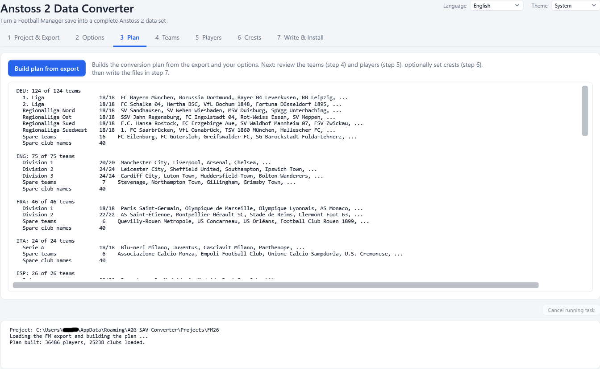

# 4. Plan

The **plan** is the converter's proposal: which club plays in which league slot of Anstoss 2, which players are in each squad, which
clubs are the non-league (Avereine) clubs. It is a proposal you can edit (tabs 4 to 6) before any file is written.

## Building the plan

Tab **3 Plan** is available once an export exists. Press **Build plan from export**. The program

1. loads the exported FM data,
2. finds out which clubs play in which league from the fixtures,
3. fills the league slots of Anstoss 2 (see [How the conversion works](11-how-conversion-works.md)),
4. picks the squads with your [Options](03-options.md),
5. chooses the non-league clubs and their players,
6. re-applies your saved manual edits.

The log says how many players and clubs were loaded and how many of your saved manual edits could be re-applied
("Re-applied 12 of 12 saved manual edits.").

Building takes a few seconds. You can build the plan again at any time, for example after changing the options, after a new export or
after **Undo all edits**. The tabs **4 Teams**, **5 Players**, **6 Crests** and **7 Write & Install** become usable as soon as a plan
exists.

## The summary

The text box below the button shows what the plan contains:

- for every country (Germany, England, France, Italy, Spain) each league with the number of clubs placed and the size Anstoss 2
  expects, for example `1. Liga: 18 of 18 teams`,
- the spare teams (clubs of a country that are in no league) and the spare club names,
- the non-league clubs: how many clubs from how many nations and how many spare clubs,
- **Warnings** - for example a league that could not be filled completely, slots that keep an original club because the FM save has no
  club for them, or non-league clubs whose squads had to be topped up from other players.

Read the warnings before you write the files. They explain every place where the result differs from a plain FM-to-Anstoss mapping.

## Manual edits survive a rebuild

Your manual work is stored in the project under the FM ids of the clubs and players, so it does not depend on one particular plan:

- **Plan edits** - team swaps and squad changes made in the **Teams** tab - are recorded as a list. When you rebuild the plan, the edits
  that still make sense are applied again. The count of re-applied edits appears in the log and above the team lists.
- **Settings-like edits** - club information, kits, skin and hair, results of the last season and crests - are stored per club or player
  and simply apply to every plan you build.

To throw the recorded plan edits away use **Undo all edits** on the **Teams** tab; it does not touch club information, kits, skin, hair,
season results or crests.

Next: [Teams](05-teams.md).
