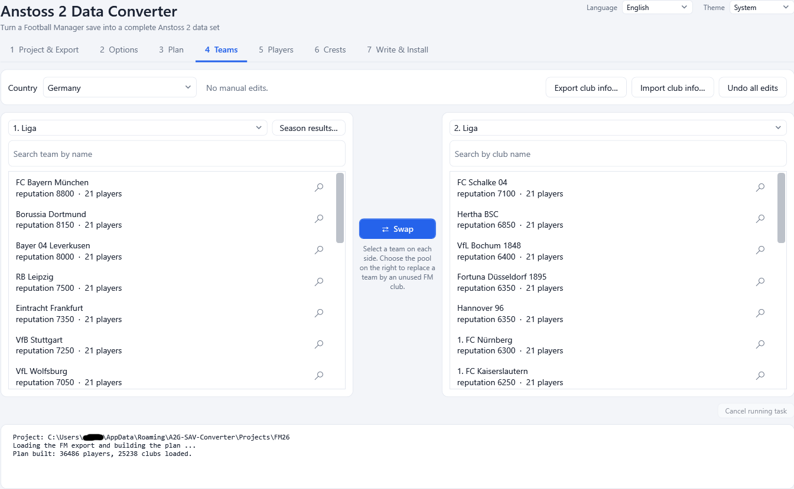
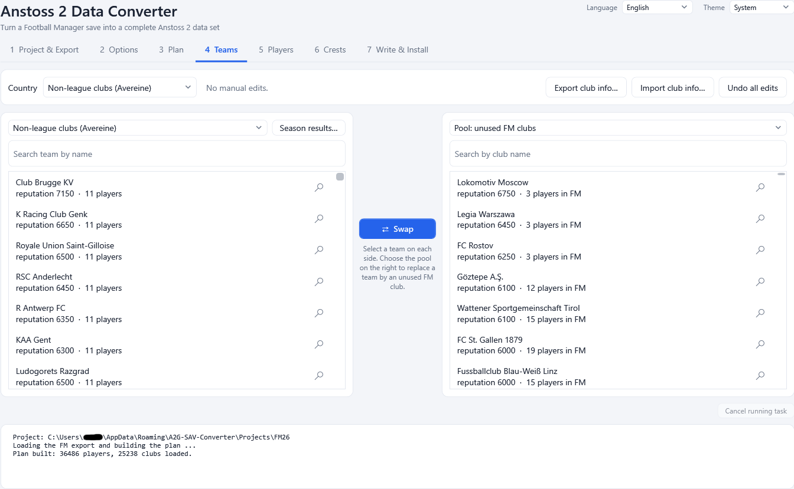
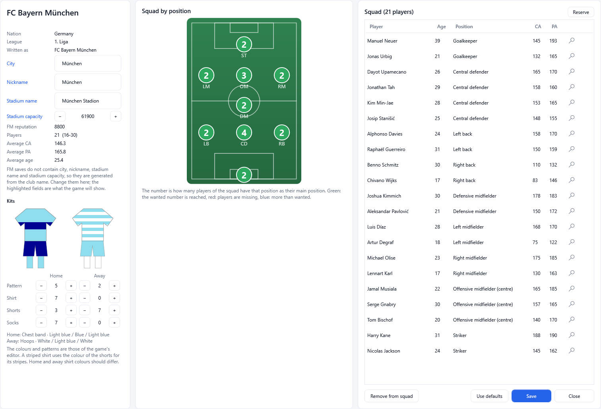
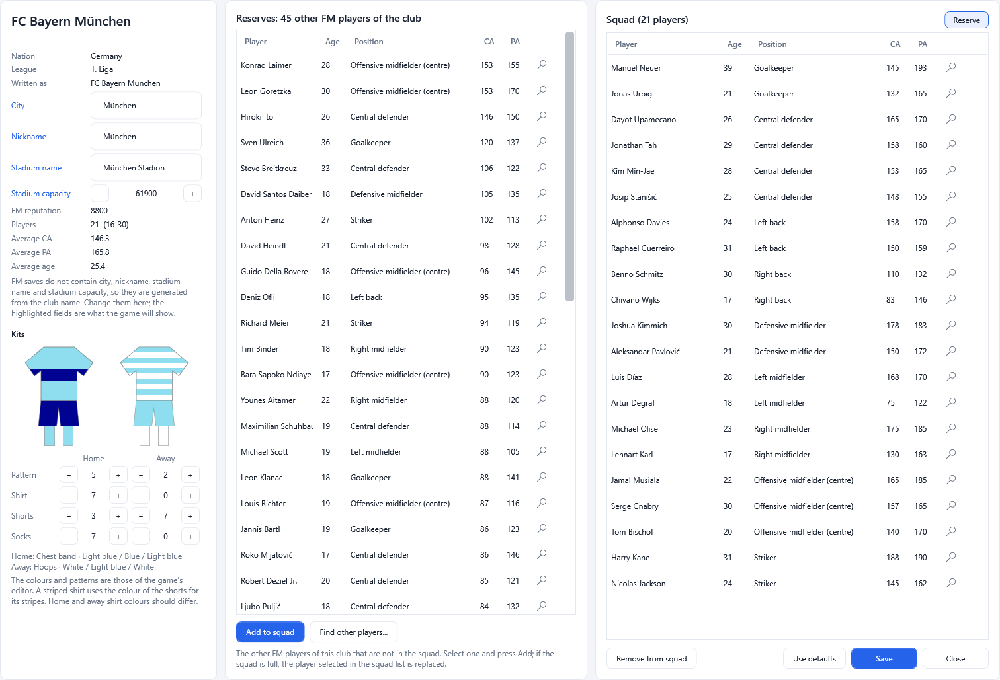
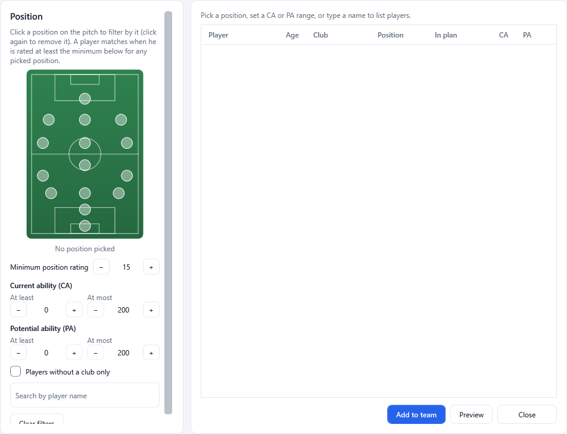
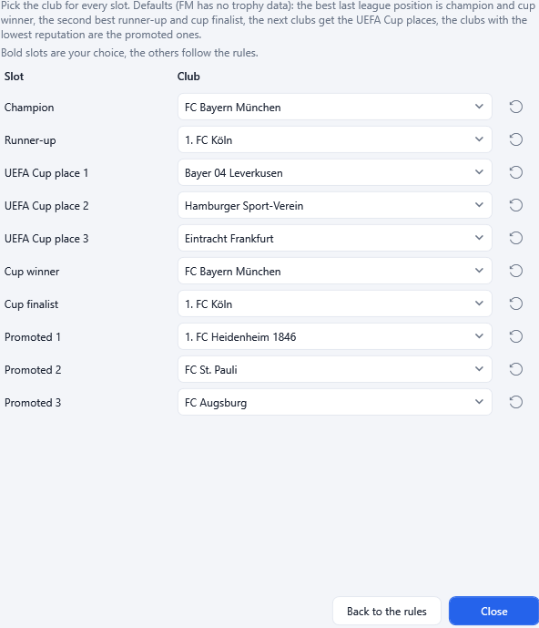
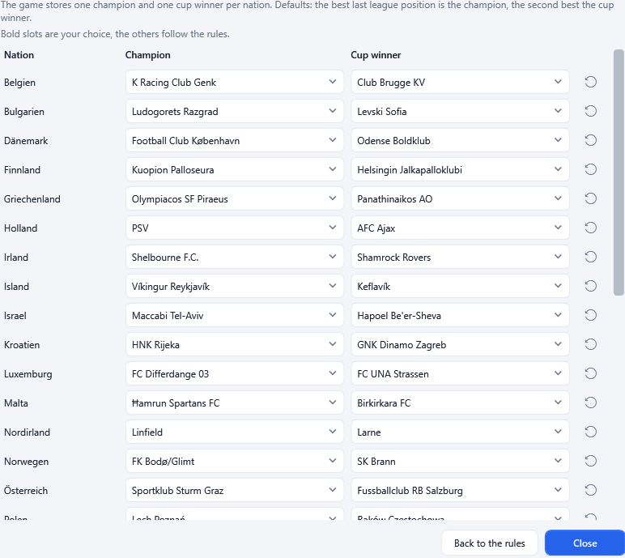

# 5. Teams

Tab **4 Teams** is where you shape the plan: which club sits in which league, who is in each squad, how clubs are called and what they
look like. It is available once a plan exists. Everything here is saved with the project.

*Tab 4: the Bundesliga on the left, the 2. Liga on the right, **Swap** in between.*

## The screen

At the top: the **Country** list, a line telling how many manual edits exist ("No manual edits." or "3 manual edit(s) recorded; they are
saved with the project and re-applied when the plan is rebuilt."), and three buttons: **Export club info...**, **Import club info...**
and **Undo all edits**.

Below are two lists with a **Swap** button between them.

- **Left list** - choose a group of teams with the box above it: a league of the chosen country, **Spare teams**, or for the entry
  **Non-league clubs (Avereine)** the list of non-league clubs. Next to the box is the **Season results...** button. Under the box is a
  search field: **Search team by name**.
- **Right list** - choose another league of the same country, the spare teams, or **Pool: unused FM clubs** (clubs that are not part of
  the plan). It has its own search field (**Search by club name**).
- Each row shows the club name, its FM reputation and the number of players ("reputation 8800 · 21 players"); a warning sign follows when
  the team has problems (for example too few players).
- The magnifier at the right of a row opens the team information; so does a double-click on the row.

### Countries and groups

| Country entry | Groups |
|---------------|--------|
| Germany | 1. Liga, 2. Liga, the four Regionalligen (Nord, Ost, Sued, Suedwest), Spare teams |
| England | the three league tiers, Spare teams |
| France | two league tiers, Spare teams |
| Italy | the league, Spare teams |
| Spain | the league, Spare teams |
| Non-league clubs (Avereine) | all non-league clubs |

League sizes in Anstoss 2 are fixed; swapping keeps every league at its size.

*The entry "Non-league clubs (Avereine)" lists the non-league clubs.*

## Swapping teams

1. Pick the group on the left and select a team.
2. Pick another group (or the pool) on the right and select a team.
3. Press **Swap**.

What happens:

- Two teams swap their league slots (a team can move up or down a division this way). Swapping inside one league changes nothing, so
  the right list never offers the league that is open on the left.
- With **Pool: unused FM clubs** on the right, the selected pool club **replaces** the left team; the replaced club moves to the pool.
- Teams can only be swapped **inside one country**.
- For **Non-league clubs (Avereine)** a club can only be replaced by a club of the **same nation**, because the game expects a fixed
  number of clubs per nation.

Every swap is recorded; the edit counter at the top goes up. **Undo all edits** (after a confirmation) discards all recorded plan edits
and rebuilds the plan.

## Team information (double-click or magnifier)

The window shows everything about one team and is where squads are edited.

*Facts and club information on the left (with the kits below), the squad by position in the middle, the squad list on the right.*

### Facts

Nation, league, how the club name is written in Anstoss 2 (**Written as**), FM reputation, number of players, average CA, average PA and
average age. A team that is not in the plan (a pool club) shows the squad the converter *would* pick.

### Club information

An FM save does not contain city, nickname, stadium name or stadium size, so the program generates them from the club name. Change
them here:

| Field | Limit | Default |
|-------|-------|---------|
| **City** | 16 characters | the place word of the club name |
| **Nickname** | 18 characters | the city |
| **Stadium name** | 26 characters | "<city> Stadion" |
| **Stadium capacity** | 3,000 to 110,000 | from the club's reputation |

The highlighted fields are what the game will show. **Save** stores your changes, **Use defaults** removes them. If you change only the
city, a nickname and stadium name that are still the default follow it. The stadium's section capacities are rescaled to your capacity.

### Kits

Home and away kit, each with four steppers: **Pattern**, **Shirt**, **Shorts**, **Socks**, and a drawing that updates immediately.

- Patterns: **Plain**, **Vertical stripes**, **Hoops**, **Halves**, **Shoulders**, **Chest band**, **Sleeves**.
- Colours (13 in the game): White, Red, Yellow, Blue, Light green, Dark green, Teal, Light blue, Brown, Purple, Orange, Dark grey,
  Maroon.
- A striped shirt uses the colour of the **shorts** for its stripes. Home and away shirt colours should differ.

Every club has a made-up default kit (FM saves have no kit data); **Save** stores a changed kit, **Use defaults** removes it. The
generated crest uses the home kit colours.

### Squad by position

A vertical pitch shows the ten Anstoss 2 positions with the number of players the team has there. **Green**: the wanted number is
reached; **red**: players are missing; **blue**: more than wanted. A **Problems** line lists everything that stops the team from being
valid.

### Squad list and reserves

- The **Squad** list shows the players. Double-click a player (or use the magnifier) for the [conversion preview](06-players.md); in that
  preview the arrow buttons and the left/right arrow keys step through the players of the team.
- **Remove from squad** takes the selected player out.
- The **Reserve** switch shows the club's other FM players that are not in the squad. Select one and press **Add to squad**; if the
  squad is full, the player selected in the squad list is replaced.
- **Find other players...** opens the player search ([below](#finding-players)): players of any club can join this team.

*The Reserve view lists the club's other FM players.*

Rules the program enforces:

- A team has **16 to 30 players** (Avereine clubs exactly **11**).
- A player belongs to **one squad only**. Adding a player who is in another squad moves him; this is refused when the other squad would
  fall below its minimum.
- Anstoss 2 players are at least **17 years old**; younger players cannot be added.

### Finding players

The player search window helps to find anybody in the FM data:

- Click a position on the pitch to filter by it (click again to remove it). A player matches when he is rated at least the
  **Minimum position rating** for any picked position.
- Filter by **Current ability (CA)** and **Potential ability (PA)** ranges, by name, or **Players without a club only**.
- The list shows player, age, club, position, whether the player is in the plan, CA and PA. **Add to team** adds the selected player,
  **Preview** opens the conversion preview, **Clear filters** resets the filters and **Close** leaves the window.
- "First N of M players shown - narrow the filter." means there are more matches than shown.

## Club information in Excel

The club information of **all** clubs in the plan (every nation) can be edited in a spreadsheet.

- **Export club info...** writes an Excel workbook (`.xlsx`; a CSV file is possible too). The sheet has a frozen header row with a
  filter. Grey columns identify the club and are ignored on import: **ClubId**, **Nation**, **League**, **Club (FM)**, **Written as**.
  The yellow columns are yours: **City**, **Nickname**, **Stadium**, **Capacity** and eight kit columns (home and away **pattern**,
  **shirt**, **shorts**, **socks**). Excel checks the lengths and numbers while you type.
- The workbook has two more sheets: **Info** (instructions) and **Kits** (the list of colour and pattern numbers; kit cells show the
  colour of their number).
- **Import club info...** reads a workbook or CSV back. Clubs are found by the **ClubId** column; unknown ids are skipped and counted.
  The log reports `Read N clubs: X changed, Y unchanged, Z not found in this save.`

Tips: do not change the ClubId column or the header row; you may sort, filter and delete the rows of clubs you do not want to change;
leave a cell empty to use the default; leave all eight kit cells of a club empty to keep its kit.

The same club information is also kept in a [shared library](12-files-and-folders.md) so that new projects start with your texts, kits
and crests.

## Season results

Anstoss 2 remembers last season's result of every team (champion, runner-up, UEFA Cup places, cup winner and finalist, promoted and
relegated) and shows it as markers on the teams. FM has no such data for a fresh career, so the converter decides it by rules and
**Season results...** lets you decide it yourself.

Press **Season results...** (next to the group box on the left) for the open league:

- The window lists the **slots** of the league and, for every slot, a box with the clubs of that league:
  - top division: **Champion**, **Runner-up**, several **UEFA Cup place** slots, **Cup winner**, **Cup finalist** and **Promoted**
    slots;
  - lower divisions: **Relegated** and **Promoted** slots.
- Pick the club for a slot. A club moves into the slot and swaps places with the club that held it. A club can be champion and cup
  winner at the same time.
- Slots you chose are shown in **bold**; the reset button next to a slot returns it to the rule, **Back to the rules** resets the
  whole league.
- The **rules** (FM has no trophy data): the best last league position is champion and cup winner, the second best is runner-up and cup
  finalist, the next clubs get the UEFA Cup places; the clubs with the lowest reputation are promoted; in lower divisions the clubs
  with the highest reputation are relegated.
- The number of UEFA, promoted and relegated slots follows the original data of that league.

For **Non-league clubs (Avereine)** the entry opens a list of every nation the game stores, each with a **Champion** and a **Cup
winner** box. The defaults are the best and the second best last league position of the nation. Nations without FM clubs show "the
original clubs of the game are kept".

Spare teams are in no league and have no results.

Next: [Players](06-players.md).
