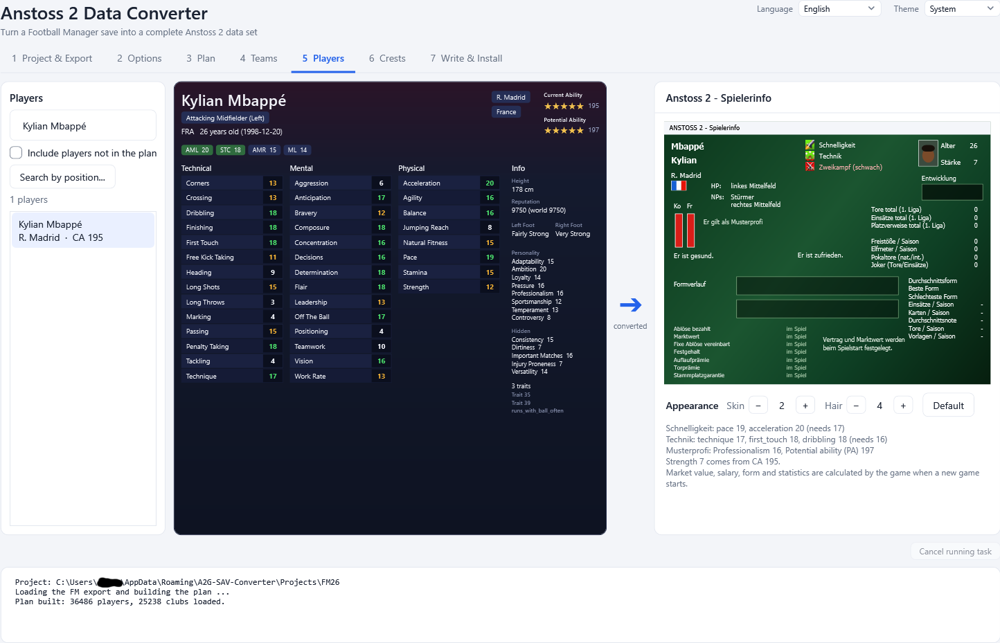

# 6. Players

Tab **5 Players** shows any player twice: the way Football Manager sees him, and the way Anstoss 2 will show him after the conversion.
It is the best place to check whether your [Options](03-options.md) produce the values you want. The tab is available once a plan
exists.

*Tab 5: the player list on the left, the Football Manager profile in the middle, the Anstoss 2 "Spielerinfo" on the right.*

## Finding a player

On the left is the player list.

- **Search by player or club name** - type part of a name; the list narrows while you type. The count under the search field shows the
  number of matches ("first 300 matches shown" when there are more).
- **Include players not in the plan** - by default the list only contains players who are in a squad of the plan (they are marked
  *converted*). Tick the box to search all players of the FM save.
- **Search by position...** (button below the list) - opens the player search with the position picker and the CA / PA filters (the same
  window as in the team information, see [Teams](05-teams.md#finding-players)). Pick a player there and press **Show in list** to
  jump to him.

Select a player to see the two sides.

## The two sides

### Left: the Football Manager profile

The player as FM shows him: name, nation, age and birth date, the star ratings (current and potential ability), positions with their
ratings, the technical, mental, physical and goalkeeping attributes with FM's colours, left and right foot, personality values, FM's
hidden attributes (consistency, dirtiness, important matches, injury proneness, versatility) and the player's traits.

### Right: the Anstoss 2 "Spielerinfo"

A replica of the game's own player window showing what the converted player looks like: last and first name (in the game's length
limits), club, age, **strength** (1 to 7), main position and secondary positions, the abilities (green) and weaknesses (red), the
character description and a portrait with the chosen skin and hair. A line under it explains where the strength comes from
("Strength 5 comes from CA 128.") and which rule produced each ability.

Market value, salary, form and statistics are **calculated by the game** when a new game starts; the preview says so.

The preview always uses your current settings, so changing a value in **Options** and pressing **Apply to preview** updates it.

## Skin and hair

FM saves contain no appearance data. The converter fills in a rough default:

- **Skin** (0 light, 1 medium, 2 dark) follows the player's nationality using a share per nation (the same player always gets the same
  result).
- **Hair** (0 very light blond, 1 golden blond, 2 brown, 3 red, 4 black, 5 bald) follows skin and age; a few older players are bald.

Under the preview, the **Appearance** row has two steppers, **Skin** and **Hair**, and a **Default** button that undoes your changes for
this player. Changes are stored per player and survive rebuilding the plan.

## A note about Avereine players

Players of a non-league club (Avereine) are marked in the preview. When the game loads such players it may change values like the
strength: there is a random factor. The values in the game can therefore differ from the preview and from the file the converter
writes. This is a property of the game, not of the converter.

## Preview from a team

The same preview opens from the team information (double-click a player). When it was opened from a team, the arrow buttons and the
left and right arrow keys step through the players of that team.

Next: [Crests](07-crests.md).
