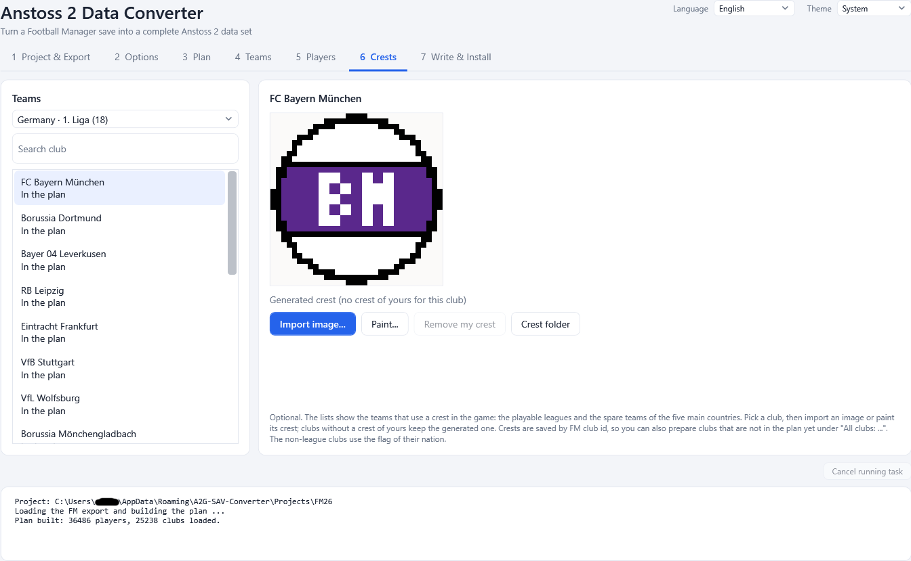
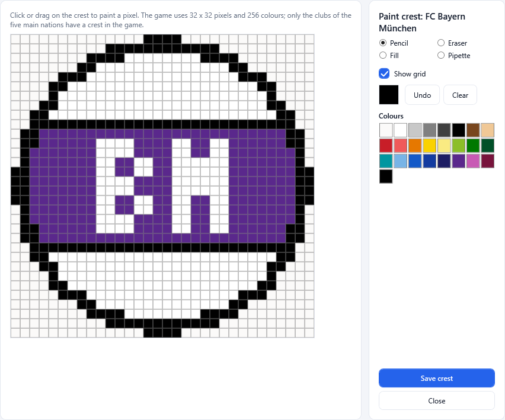

# 7. Crests

Tab **6 Crests** is optional. Anstoss 2 shows a crest next to every team of the five main countries, and the crest is chosen by the
**position of the team in the country file**. When the converter puts another club into a slot, the old crest would be wrong, so the
converter generates a crest for every club. In this tab you can give clubs **your own crests** instead.

## What the game uses

- Crests are 32 x 32 pixel pictures with 256 colours (`VW_*.BMP` files in the game's `WAPPEN` folder).
- Only the teams of **Germany, England, France, Italy and Spain** have crests (playable leagues and the spare teams of these
  countries). Non-league (Avereine) clubs show the flag of their nation.
- Without your own image a club gets a **generated crest**: a round badge in the club's colours (taken from the home kit) with two or
  three letters from the club name.

## The screen

- **Left**: the nations. For each of the five countries the groups of the plan come first, then an entry **All clubs: <nation>** that
  lists every FM club of the nation, including clubs that are not in the plan yet (crests are saved by FM club id, so you can prepare
  them in advance). A search field (**Search club**) filters the list.
- **Middle**: the clubs of the chosen group, marked **In the plan** where they are in the plan and **Own crest** where you gave them one.
- **Right**: a large preview. The caption says **Generated crest (no crest of yours for this club)** or **Your crest: <file>**.

## Buttons

| Button | What it does |
|--------|--------------|
| **Import image...** | Choose a picture (`.png`, `.bmp`, `.jpg`, `.jpeg`, `.gif`, any size). It is scaled to 32 x 32 (keeping its proportions; transparent areas become the off-white background of the original crests) and reduced to 256 colours. A BMP that is already 32 x 32 with 256 colours is used unchanged. |
| **Paint...** | Opens the pixel painter (below), starting from the current crest. |
| **Remove my crest** | Deletes your crest for the club; the generated crest is used again. |
| **Crest folder** | Opens the project's `Crests` folder in Explorer. You can also drop images there yourself. |

### The crest folder

Each project has a `Crests` folder (created with a `README.txt` and `_club-ids.csv`, the list of FM club ids). An image whose **file name
starts with the FM club id** belongs to that club: `1234.png`, `1234 - Bayern.bmp`, `1234.bmp`. This lets you collect crests for many
clubs with any image tool and drop them in. Your crests are also kept in the shared library so that new projects start with them
([Files and folders](12-files-and-folders.md)).

## The pixel painter

**Paint...** opens an editor for the 32 x 32 crest:

| Tool | Use |
|------|-----|
| **Pencil** | Click or drag on the crest to paint pixels in the chosen colour. |
| **Eraser** | Paints the crest background. |
| **Fill** | Fills an area of one colour. |
| **Pipette** | Picks a colour from the crest. |
| **Undo** | Steps back. |
| **Clear** | Empties the crest. |

Choose the colour in the **Colours** palette. **Show grid** draws the pixel grid. **Save crest** stores the result as `<club id>.bmp` in
the crest folder.

## Where the crests go

When you **Write** the data files ([Write and install](08-write-and-install.md)), the crests end up in `DATA.DEF\WAPPEN` and
`DATA.VER\WAPPEN` of the output. The file `WAPPEN\Crests.md` in the output lists for every crest file which club it belongs to, where
it came from (generated, your crest, or the original crest of a slot that kept its team), and links the picture so that a Markdown
viewer can show it.

Crests are installed with a full install, and with a [partial install](08-write-and-install.md#partial-installs) as part of their
country: ticking **Germany** also installs the German crests.

Next: [Write and install](08-write-and-install.md).
