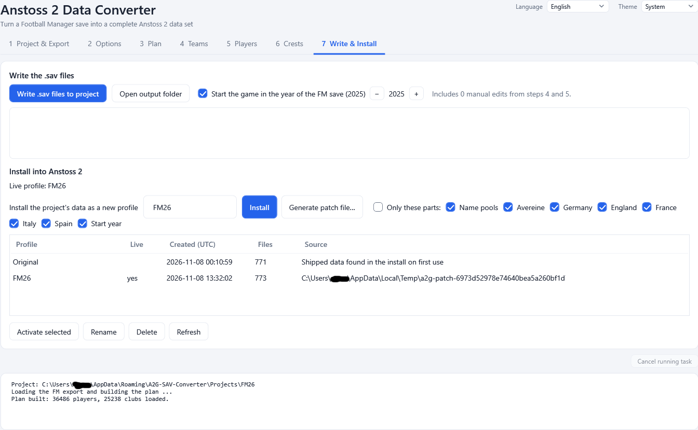

# 8. Write and install



Tab **7 Write & Install** has two halves: **Write the .sav files** (turn the plan into game files inside your project) and **Install into
Anstoss 2** (put them into the game, safely). It is available once a plan exists.

## Writing the files

Press **Write .sav files to project**. The program writes the complete set of Anstoss 2 data files into the project's `Anstoss2` folder:

```
<project>\Anstoss2\
    DATA.DEF\   *.sav and WAPPEN\ (crests)
    DATA.VER\   the same files
```

The original game keeps identical files in both folders, and so does the converter. Under the button the program tells you how many
manual edits are included ("Includes 7 manual edits from steps 4 and 5.").

The big result box below shows what happened:

- **Written files** - the list of generated files,
- **WARNING** lines - things that differ from a plain mapping, for example slots that kept an original club because the FM save had no
  club for them, nations with too few staff members, or non-league clubs whose squads were topped up,
- **NOTE** lines - for example the number of crests and where they came from,
- the **validation**: `Validation: no problems.` or a list of problems.

### Validation

After writing, the files are checked against the structure of the original files and the limits of the game: names and their
lengths, squad sizes, strength 1 to 7, ages, positions, nationality numbers, league ids, the number of players that follow each team,
the nation layout of the non-league clubs, kit values and more. `Written to <folder> (validated).` means everything is fine. If
validation reports problems, do not install; the lines name the file and the problem.

### Start year

The game starts in the year you choose; day and month are fixed (6 July), and the game knows the years 1998 to 2098.

- The check box **Start the game in the year of the FM save (YYYY)** is on by default: the year of the save's in-game date is used. If
  the save is not known yet it shows "unknown: export first".
- Untick it and set the year with the stepper to choose your own.

The year is written into `KLEINIG.SAV`.

### Open output folder

**Open output folder** opens `<project>\Anstoss2` in Explorer, for example to copy the files by hand.

### What is written

Generated from the FM data: the team files of Germany, England, France, Italy and Spain (`Land*`), the league files (`LIGA*`), the
stadium files (`Stad*`), the non-league clubs (`Avereine`), the name pools (`JUGE*`, `JUGEND*`), the trainer and staff files, the crests
and the start year. Parts that FM cannot supply (for example the sponsors) stay as in the original game. Details:
[How the conversion works](11-how-conversion-works.md).

Nothing in the game folder changes while you write.

## Installing into the game

Installing copies your written data set into the Anstoss 2 folder **as a new data set (profile)** and makes it the live one. The data
that was there before is kept as its own data set, so you can always go back ([Data sets and rollback](09-profiles.md)).

Before installing:

- **Close Anstoss 2 and its editor** (`anstoss2.exe`, `Editor.exe`). The program refuses to install while they run.
- The **Anstoss 2 folder** on tab 1 must be correct.

Steps:

1. Check the name in the box next to **Install**. It is suggested from the project name (`FM26` for a project of that name).
2. Press **Install**.
3. If you changed the live game files since the last install (for example with the game's editor), the program asks:
   *Yes* saves those changes into the data set that is live now first, *No* throws them away, *Cancel* stops.
4. The log says `Installed profile 'FM26' and made it live.`

**The first install** also stores the original data of your installation as the data set **Original**. Keep it: it is your way back.

**A name that exists already** replaces that data set after you confirm ("A data set named 'FM26' exists already. Replace it with the
new data?"). The old data of that name is lost; the **Original** data set and all others stay. The **Original** data set can never be
replaced - use another name.

### Generate patch file...

The button next to **Install** creates a single `.exe` that installs this data set on any PC: see [Patch files and the
patcher](10-patches.md).

### Partial installs

Tick **Only these parts:** to install only some files and keep everything else as it is in the live data. Then choose which parts:

| Part | Files |
|------|-------|
| **Name pools** | the national name pools `JUGE*` and the twenty youth pools `JUGEND1` to `JUGEND20` |
| **Avereine** | `Avereine.sav` (the non-league clubs) |
| **Germany**, **England**, **France**, **Italy**, **Spain** | the team file, stadium file, league files and the trainer, manager, referee and prominent person files of that country, **and the crests** of that country's teams |
| **Start year** | `KLEINIG.SAV`, the year the game starts in |

All parts are ticked by default; untick the ones you do not want. A country brings its crests along, so a partial install of Germany
also replaces the German crests and leaves the other countries' crests alone.

The result of a partial install is stored as a complete data set like every other install, so rollback works the same way.

## The data set list

The lower half of the tab lists all data sets with **Activate selected**, **Rename**, **Delete** and **Refresh**. They are described in
[Data sets (profiles) and rollback](09-profiles.md).

Next: [Data sets and rollback](09-profiles.md) or [Patch files](10-patches.md).
