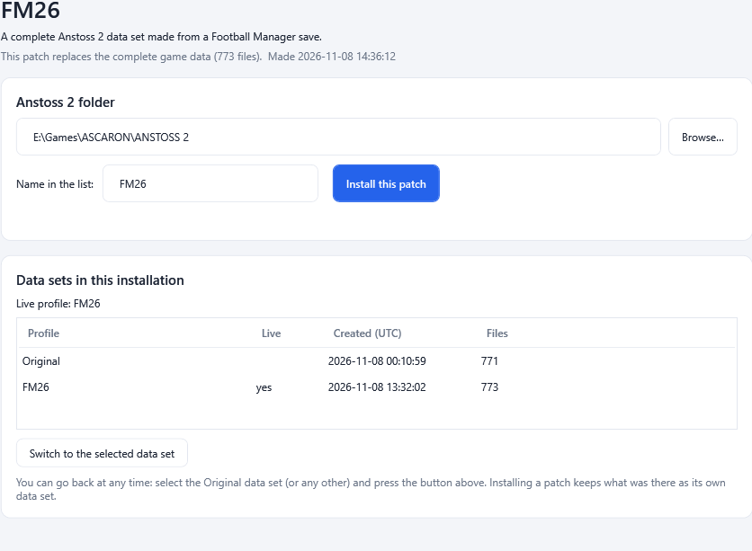

# 10. Patch files and the patcher

A **patch file** is a single `.exe` that contains your finished data set. Anyone can run it, point it at their Anstoss 2 folder and
install your work with one click - and switch back to the original data afterwards. It is the way to share a conversion without
sending a folder of files or explaining how to copy them.

A patch is the converter itself with your data attached to the end of the file. When the program finds data attached to itself, it opens
as the **patcher** (a small installer window) instead of the converter.

## Generating a patch file

On tab **7 Write & Install**, after you have written the files ([Write and install](08-write-and-install.md)):

1. Enter the name of the data set in the box next to **Install** (it is suggested from your project name, for example `FM26`).
2. Optionally tick **Only these parts** and choose the parts the patch should contain (the same choice as for a partial install; a
   partial patch only replaces those files and leaves the rest of the user's data alone).
3. Press **Generate patch file...**.
4. A small window asks for an optional **short description** shown in the patcher, and tells you the **file name that will be created**:
   `A2G-Patch_<name>.exe` - for the name `FM26`: `A2G-Patch_FM26.exe`.
5. Choose where to save it. The save dialog proposes the same file name.
6. When it is done, the program shows the size and the path. Pass this one file on.

Notes:

- The patch contains **the generated files of the open project** (what **Install** would install), not the live data of your game.
  Your game is not touched.
- If the project has no written files yet, the program asks you to write them first.
- A patch is about 12 MB plus the data (compressed). Every file in it carries a checksum; a damaged patch refuses to install.
- Characters Windows does not allow in file names are replaced by `_` in the file name.

## Using a patch file (the patcher)

*The patcher: the patch's name and description at the top, the Anstoss 2 folder, the name of the data set and **Install this patch**, then the list of data sets with **Switch to the selected data set**.*

Give the `.exe` to the player. They only need Anstoss 2; Football Manager and the converter's other parts are not needed.

1. Start the patch. The window shows the **patch name**, its **description** and a line such as `This patch replaces the complete game
   data (771 files). Made 2026-11-08 12:47:26` (for a partial patch: `This patch replaces N game files of one part of the data;
   everything else stays as it is.`).
2. **Anstoss 2 folder** is filled in automatically: the folder used last, otherwise the same search the converter does. If nothing is
   found, a message says so and asks you to choose the folder yourself with **Browse...** - it is the folder where `anstoss2.exe` is
   located and which contains `DATA.DEF` and `DATA.VER`.
3. If you choose a folder that lacks `DATA.DEF` or `DATA.VER`, a warning asks you to double check; install and switch stay disabled
   until the folder is right.
4. **Name in the list** is the name of the data set that will be created (the patch's own name by default). If a data set of that name
   exists, installing **replaces** it after you confirm; this is how you install a newer version of the same patch. The data set
   **Original** can never be replaced.
5. Press **Install this patch**. If the live game files were changed since the last install, the patcher asks whether to save those
   changes into the live data set first, discard them, or cancel. Close Anstoss 2 and its editor first.
6. The window says `The patch '<name>' is installed and live.`

### Going back

The lower half lists all **data sets in this installation**: the **Original** data, data sets from the converter and from other patches.
To go back, select the data set (for example **Original**) and press **Switch to the selected data set**. Installing a patch always
keeps what was there before as its own data set, so nothing is lost. See [Data sets (profiles) and rollback](09-profiles.md).

## Quiet install for installers

A patch can install itself without any window: `A2G-Patch_FM26.exe -q -F "C:\Games\ANSTOSS 2"`. This is meant for installers and scripts;
it never shows a window or a message box and reports problems through the exit code. See [Command line](14-command-line.md).

## Good to know

- The patch is an **unsigned** program. Windows SmartScreen or your antivirus may warn about an unknown program the first time; that is
  normal for files that are passed around between players.
- If Anstoss 2 is installed in a protected folder such as `Program Files`, Windows may deny access while installing. Start the patch
  with **Run as administrator** in that case.
- A patch contains data files only; the patcher does not change the game program.
- A patch holds a complete data set. It therefore includes parts that are unchanged from the original game and data derived from
  Football Manager. Think about the rights of the owners of both before you publish a patch.

Next: [How the conversion works](11-how-conversion-works.md).
