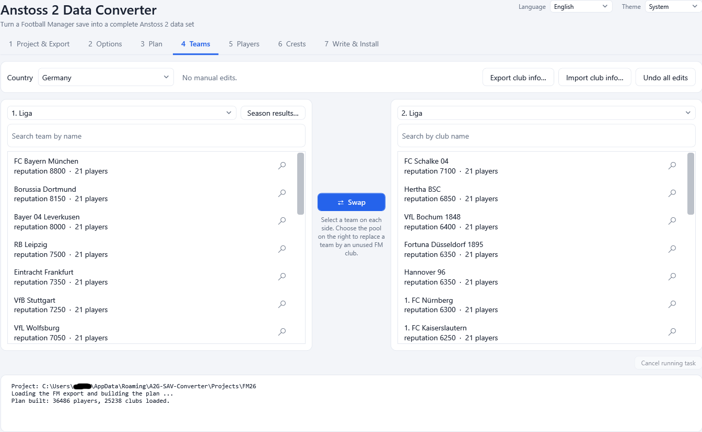

# Anstoss 2 Data Converter - User Guide

The **Anstoss 2 Data Converter** turns a **Football Manager 26 or 27** save into a complete **Anstoss 2** data set: real clubs, leagues,
players, staff, name pools, stadium sizes, kits and crests. You review and fine-tune the result inside the program, install it into your
game (with a safe way back to the original data) and, if you like, pack your work into **one `.exe` patch file** that anyone can install
with a few clicks.

The converter only writes data files (`.sav`) and crest images. It never changes the game program itself.



## Contents

| Page | What it covers |
|------|----------------|
| [1. Getting started](01-getting-started.md) | What you need, the first start, the seven steps at a glance, language and theme |
| [2. Project and export](02-project-and-export.md) | Projects, choosing the FM save and the Anstoss 2 folder, exporting from the save |
| [3. Options](03-options.md) | Squad rules, strength bands, abilities, traits and character |
| [4. Plan](04-plan.md) | Building the conversion plan and reading its summary |
| [5. Teams](05-teams.md) | Swapping teams, team information, squads, kits, club information (Excel), results of the last season |
| [6. Players](06-players.md) | Inspecting a player, the Anstoss 2 preview, skin and hair |
| [7. Crests](07-crests.md) | Your own crests, importing images, the pixel painter |
| [8. Write and install](08-write-and-install.md) | Writing the files, start year, installing into the game, partial installs |
| [9. Data sets (profiles) and rollback](09-profiles.md) | How installs are kept, switching back to the original data |
| [10. Patch files and the patcher](10-patches.md) | Generating a patch `.exe`, using it, the quiet install for installers |
| [11. How the conversion works](11-how-conversion-works.md) | The rules behind the result: leagues, squads, players, names, defaults |
| [12. Files and folders](12-files-and-folders.md) | Where the program keeps projects, settings and the shared library |
| [13. Troubleshooting and FAQ](13-troubleshooting.md) | Messages, common problems, limits of the game |
| [14. Command line](14-command-line.md) | Options of the converter and of a patch file |
| [15. Glossary](15-glossary.md) | Terms used in this guide |
| [16. About](16-about.md) | Credits, licenses and disclaimer |

## The workflow in one picture

```
FM save (.fm)  ->  1 Project & Export  ->  2 Options  ->  3 Plan  ->  4 Teams / 5 Players / 6 Crests
                                                                              |
                                          9 Profiles (rollback)  <-  7 Write & Install  ->  10 Patch file
```

1. **Project & Export** - pick or create a project, choose the save, export the data.
2. **Options** - decide how squads are picked and how FM ratings become Anstoss 2 values (the defaults work).
3. **Plan** - build the conversion plan.
4. **Teams** - swap clubs between leagues, edit squads, club texts, kits and the last season's results.
5. **Players** - look at any player as FM sees him and as Anstoss 2 will show him.
6. **Crests** - optional own crests.
7. **Write & Install** - write the data files and install them into the game as a new data set; or generate a patch file.

## Conventions in this guide

- Names in **bold** are buttons, tabs and fields exactly as the program shows them (English interface; the program also has a German
  interface - use the **Language** box in the top right corner).
- "FM" means Football Manager, "A2" or "Anstoss 2" means the game you are converting to.
- A **data set** (also called **profile**) is a complete copy of the game's data folders that you can switch to at any time.
- Paths such as `C:\Games\ANSTOSS 2` are only examples; use your own folders.
